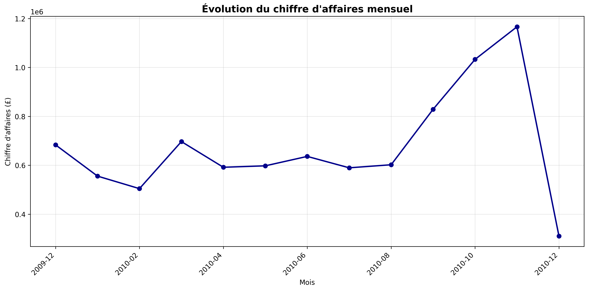
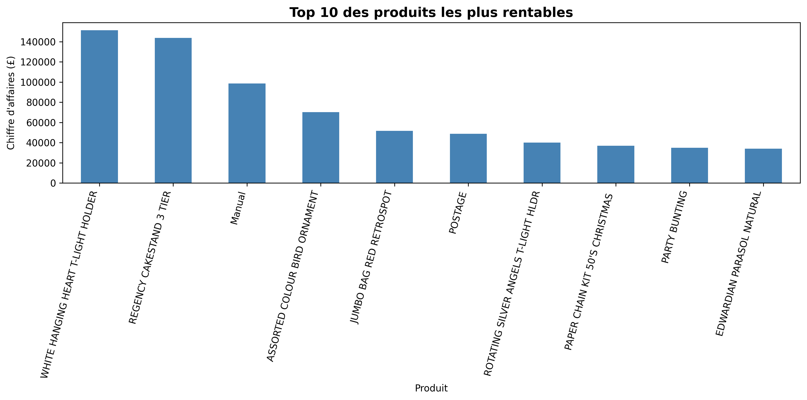

# 🛍️ Analyse des ventes d'une boutique en ligne – Online Retail II


Analyse des ventes **réelles** d'une boutique en ligne britannique (articles de décoration et de cadeaux,
clients particuliers et grossistes) à partir du jeu de données public **Online Retail II**.

## 🎯 Questions métier

1. Quel est le chiffre d'affaires réel une fois les données nettoyées ?
2. Quels produits rapportent le plus ?
3. Quel est le panier moyen par commande ?
4. Comment les ventes évoluent-elles au fil de l'année ?

## 🧹 Nettoyage des données

| Étape | Résultat |
|---|---|
| Lignes brutes | **525 461** (décembre 2009 → décembre 2010) |
| Doublons supprimés | 6 865 |
| Lignes sans client, ou avec une quantité ou un prix négatif ou nul (retours, annulations) | 117 680 |
| **Lignes conservées** | **400 916** |

## 📌 Résultats

| Indicateur | Valeur |
|---|---|
| Chiffre d'affaires | **8,80 M£** |
| Panier moyen par facture | **457,93 £** (médiane : 302,90 £) |
| Meilleur mois | **Novembre 2010 : 1,17 M£** |
| Produit n°1 | *White Hanging Heart T-Light Holder* : 151 339 £ |

**Saisonnalité marquée** : le chiffre d'affaires double entre l'été (~ 600 K£/mois) et novembre (1,17 M£),
porté par les achats de Noël. Décembre 2010 n'est que partiellement couvert par les données.

| Ventes mensuelles | Top 10 des produits |
|---|---|
|  |  |

## 💡 Recommandations

- **Anticiper les stocks dès septembre** : la demande augmente fortement de septembre à novembre.
- **Mettre en avant les best-sellers** (bougeoirs, présentoirs à gâteaux, décorations) dans les campagnes de fin d'année.
- **Fiabiliser la saisie** : environ 20 % des lignes n'ont pas d'identifiant client, ce qui limite l'analyse de la fidélité.

## ▶️ Reproduire l'analyse

1. Télécharger le fichier `online_retail_II.xlsx` depuis
   [UCI Machine Learning Repository](https://archive.ics.uci.edu/dataset/502/online+retail+ii)
   (licence CC BY 4.0) et le placer dans `Data/`.
2. Lancer :

```bash
pip install -r requirements.txt
python analyse_ventes_boutique.py
```

Le rapport détaillé est disponible dans `docs/`.

## 🛠️ Compétences

`Python` · `pandas` · `nettoyage de données` · `analyse exploratoire` · `séries temporelles` · `Matplotlib` · `recommandations métier`

---
Khadija Ibisk – Ynov Campus
